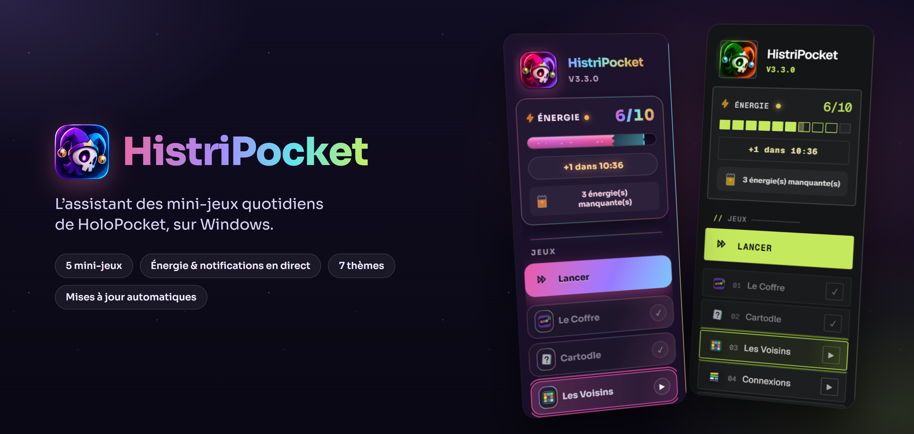
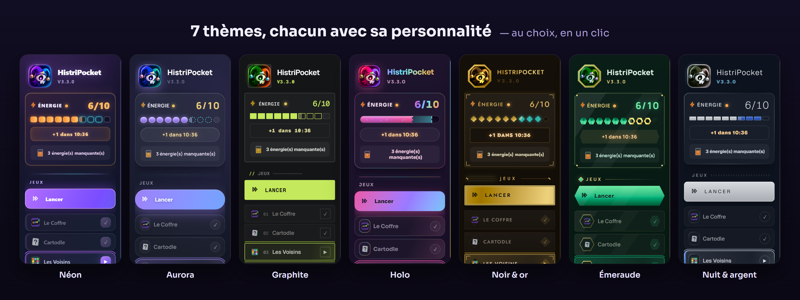

  

  <a href="https://github.com/Histrion21/HistriPocket-releases/releases/latest"><b>⬇ Télécharger la dernière version</b></a>
  &nbsp;·&nbsp; Windows 10 / 11

---

## Ce que fait HistriPocket

- **Les 5 mini-jeux du jour en un clic** : Le Coffre, Cartodle, Les Voisins, Connexions et Voltorbe Flip.
- **Rien en double** : un jeu déjà fait aujourd’hui est passé automatiquement.
- **Le reset de minuit en direct** : le bouton « Lancer » se remplit au fil de la journée, puis toute
  la barre se réveille (avec un petit son) quand les quotidiens reviennent.
- **HistriPocket Live** : ton énergie, sa recharge, le booster et tes notifications HoloPocket en direct,
  chaque type de notification avec son icône.
- **Mode compact** : une petite barre posée sur la barre des tâches de Windows, avec ton énergie et
  ton booster, pendant que tu fais autre chose.
- **Nouveautés HoloPocket** : l’app te prévient des notes de mise à jour, des nouvelles cartes et
  des nouveaux jeux.
- **7 thèmes** au choix, chacun avec sa personnalité, ses animations et ses formes.
- **Mises à jour automatiques** : l’app se met à jour toute seule, rien à retélécharger.

## Installer

1. Télécharge **`HistriPocket-Setup-x.y.z.exe`** depuis la [dernière version](https://github.com/Histrion21/HistriPocket-releases/releases/latest).
2. Lance-le. Si Windows affiche *« Windows a protégé votre ordinateur »*, clique sur
   **Informations complémentaires**, puis **Exécuter quand même** (l’app n’est pas signée,
   c’est normal pour un petit projet).
3. Dans l’app, **connecte-toi une fois** à HoloPocket dans le site intégré. C’est tout.

## Les thèmes

  

L’icône **⚙ Réglages**, en bas de la barre latérale, permet de changer de thème à tout moment, de
couper les sons et de lancer HistriPocket au démarrage de Windows.

---

Projet de fan, gratuit et non officiel. Sans lien avec HoloPocket, Nintendo, Creatures, GAME FREAK
ou The Pokémon Company. Pokémon et les noms associés sont des marques de leurs propriétaires respectifs.
